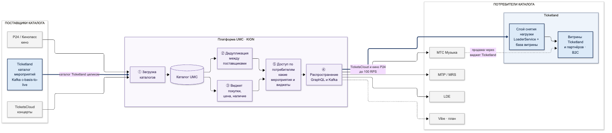

# Кодекс взаимодействия команд Ticketland и KION по платформе UMC

**Версия 0.6 от 06.10.2026** · по итогам встречи «Согласовать документы UMC/Ticketland» 06.10.2026
**Владельцы интеграции:** Ticketland — А. Ишманов, В. Романов · KION — С. Геворкян, Р. Матиев

## 1. Краткая суть

- **Ticketland и KION связаны через UMC дважды.** Ticketland отдаёт в UMC весь свой каталог, а получает из UMC каталоги TicketsCloud и кино P24 вместе с виджетом покупки.
- **Связь взаимная.** Каталог Ticketland из UMC читают МТС Музыка, МПР и LDE, а Музыка продаёт мероприятия TicketsCloud через виджет Ticketland.
- **Владелец сервиса — KION, Ticketland контрибутит без ограничений.** Документ фиксирует, как стороны работают вместе, в том числе если Ticketland и KION станут разными юрлицами:
  - договорённости и ответственных — раздел 2;
  - карту связей — раздел 3;
  - порядок работы над доработками UMC — раздел 4.

## 2. Договорённости

| # | Договорённость | Что договорились 06.10 | Ответственные |
|---|---|---|---|
| 1 | Владельцы интеграции | Точка эскалации и согласования изменений этого документа | Ticketland — А. Ишманов, В. Романов; KION — С. Геворкян, Р. Матиев |
| 2 | Доработки UMC | Владелец сервиса — KION. Ticketland контрибутит в UMC без ограничений, KION проводит оперативное техревью по порядку раздела 4 | KION — техревью; Ticketland — доработки |
| 3 | Отключение или разрыв потока | KION оповещает Ticketland не менее чем за 90 дней, чтобы Ticketland успел подготовить работы | Архитекторы KION |
| 4 | Нагрузка | Гарантированная нагрузка Ticketland — 100 RPS, дополнительные ограничения не установлены; при изменении KION заранее оповещает Ticketland. Прямых обращений B2C в UMC нет: между UMC и B2C стоит слой снятия и балансировки нагрузки. UMC не рассчитан на волнообразную нагрузку | KION — Р. Матиев (лимиты); Ticketland — слой между UMC и B2C |
| 5 | Доступ Ticketland к UMC | Выдача и изменение доступов Ticketland к UMC | Р. Матиев |
| 6 | Изменения API, Kafka, форматов | Изменения публикуются на отдельной странице Confluence, оповещения приходят оттуда | Р. Матиев |
| 7 | Персональные данные и обмен данными | Вопросы ПДн решает юридический отдел. Между системами нужен договор обмена данными | Юридический отдел — А. Хромов |
| 8 | Плановые нагрузки и релизы | UMC ведёт свои релизы и во время релиза может быть недоступен. Ticketland заранее оповещает UMC о плановых нагрузках. Основная нагрузка — бутстрап (зашли, выгрузили, ушли): окно выгрузки согласуется с командой UMC, при переносе дат — согласуется заново | Ticketland — оповещение; команда UMC — окно выгрузки |
| 9 | Техническое обслуживание и поддержка | Неформальный SLA: первичный ответ — в течение суток, разбор ситуации — в течение недели. Обращения дублируются на email; на практике подходит и MTS.Link | А. Уланенко |
| 10 | Доступ к общему Observability | Ticketland получает общий доступ на чтение; расширенные права — через техподдержку | Техподдержка UMC |

**Не обсуждали — на следующий синк:**
- Отдельный ключ витрины Ticketland и порядок его смены.
- Срок поддержки старой версии API после ломающих изменений.
- Полная выгрузка данных UMC для витрины при выходе и резервный путь TicketsCloud → Ticketland.
- Форма юридического оформления при разделении юрлиц и сроки договора обмена данными.

<!-- landscape -->

## 3. Карта зависимостей KION / Ticketland

| Точка связи | Что происходит | Кто от кого зависит |
|---|---|---|
| Каталог Ticketland → UMC | Ticketland публикует весь каталог в Kafka `c-basis-to-live` (19 топиков и остатки), UMC загружает его | KION от Ticketland: без него у Музыки, МПР и LDE нет каталога Ticketland |
| ① Загрузка каталогов | UMC загружает каталоги TicketsCloud и P24 | Ticketland от KION |
| ② Дедупликация | UMC склеивает одно и то же мероприятие от разных поставщиков: почти весь репертуар пересекается | Ticketland от KION: без склейки на витрине дубли |
| ③ Виджет, цена, наличие | UMC хранит, у кого покупать, минимальную цену и наличие билетов | Ticketland от KION — покупка TicketsCloud и кино; KION от Ticketland — потребители UMC используют виджет Ticketland |
| ⑤ Доступ по потребителям | UMC решает, какие мероприятия и виджеты видит каждый потребитель; Ticketland читает TicketsCloud по ключу витрины | Ticketland от KION |
| ④ Распространение | Ticketland читает UMC до 100 RPS через GraphQL и Kafka в свою базу витрины; B2C-трафик идёт в витрины, не в UMC | Ticketland от KION |
| Продажа через виджет Ticketland | Музыка продаёт мероприятия TicketsCloud через виджет Ticketland | KION от Ticketland |

<!-- /landscape -->

## 4. Процессы взаимодействия по доработкам UMC

**Принцип.** Владелец сервиса — KION. Ticketland вносит доработки в UMC без ограничений; KION отвечает за ревью, выкладку и работу сервиса. Ревью — оперативное: доработки Ticketland не ждут планирования KION.

| Шаг | Что происходит | Кто | Срок |
|---|---|---|---|
| 1. Задача | Задача в Jira Ticketland с пометкой `[UMC]`, ссылка — в чате техподдержки UMC | Ticketland | — |
| 2. Разработка | По стандартам кода и выкладки UMC | Ticketland | по плану Ticketland |
| 3. Запрос на ревью | Merge request в репозиторий UMC, ссылка — в чате техподдержки | Ticketland | — |
| 4. Техревью | Ревью кода и архитектуры; замечания — в merge request, отказ — с причиной и тем, что исправить | KION | оперативно, целевой срок — до 5 рабочих дней |
| 5. Выкладка | Решение о выкладке в прод, анонс в чате | KION | заранее |
| 6. Поддержка | Ошибки в доработках Ticketland исправляет Ticketland; сервис и инфраструктура — KION | Ticketland / KION | по приоритету |

**Изменения UMC, которые затрагивают Ticketland.**
- Изменения API публикуются на странице изменений в Confluence, оповещения приходят оттуда (п. 6).
- Изменение лимитов нагрузки — с оповещением заранее (п. 4).
- Отключение потока — не менее чем за 90 дней (п. 3).

**Плановые выгрузки Ticketland (п. 8).**
1. Ticketland заранее сообщает команде UMC дату и объём выгрузки (бутстрапа).
2. Команды согласуют окно так, чтобы оно не попало на релиз UMC.
3. Если дата сдвигается, окно согласуется заново.

**Инциденты и техническое обслуживание (п. 9).**
- Обращение — задача в Jira одной из сторон и сообщение в чате техподдержки, продублированное на email.
- Ответственный со стороны UMC — А. Уланенко.
- Первичный ответ — в течение суток, разбор ситуации — в течение недели. Это неформальная договорённость.
- Для диагностики Ticketland смотрит общий Observability UMC с доступом на чтение (п. 10).
- После разбора — краткий итог в чате.

**Регулярная связь.**
- Чат «UMC → GDS: техподдержка» — оперативные вопросы; важное дублируется на email, MTS.Link тоже подходит.
- Чат интеграции UMC → Loader → WebDB — технические детали.
- Синк PO и лидов — еженедельно, 15 минут.

Решения записываются в раздел 2 с датой.
